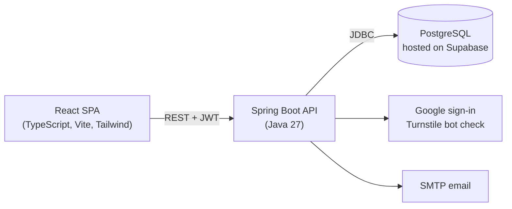

# Formularium

**A workbench for home skincare formulators:** design a recipe in percentages, get instant safety and compatibility checks, then turn it into a real batch with stash tracking, costs and printable lab sheets.

[](https://github.com/lampros-polyzos/formularium/actions/workflows/ci.yml)
    

## Why it exists

Hobbyists mix creams and serums from forum posts and spreadsheets, with no check that the percentages add up, that an ingredient is within its usage limit, or that two actives work together. Formularium puts that knowledge into a tool: the rules run as you type, and the whole workflow lives in one place, from the first idea to the logged batch.

## What you can do

- **Formulate:** phases and percentages, auto-balancing to 100%, a library of 100+ cosmetic ingredients, one-click fixes for problems it finds, import of a recipe from text, version history.
- **Validate:** traffic-light checks for total percentage, usage limits, pH, product-type constraints, ingredient interactions, preservation and stability, plus EU limits (Regulation 1223/2009, Annexes III and V).
- **Make it:** turn a formula into a batch at any size. The stash is deducted and the cost worked out in one transaction. Follow it step by step in bench mode, with timers and check-ins.
- **Plan and print:** "what can I make with what I own", a shopping list, a sourcing guide, and PDF product information files and batch records.
- **Learn and share:** calculators (HLB, dilutions and more), beginner guides, and a community for sharing, remixing, rating and discussing recipes, with reports, muting and moderation.

## How it is built



Supabase is used **only as a PostgreSQL host**. Authentication, authorization, validation, business rules, PDF export and email all live in the Spring backend; the React app talks to nothing else.

| Layer | Choices |
|---|---|
| Frontend | React 19, TypeScript, Vite, Tailwind CSS 4, React Router, Vitest + Testing Library |
| Backend | Spring Boot 4, Spring Security (JWT resource server), `JdbcClient` (plain SQL, no ORM), OpenPDF, Bean Validation |
| Database | PostgreSQL with versioned SQL migrations in [`supabase/migrations`](supabase/migrations) |
| Tooling | GitHub Actions CI, a pre-commit hook that blocks leaked secrets |

## Engineering highlights

**Frontend**
- **Typed data layer.** One API client handles auth headers, error shapes and a single-flight silent token refresh: parallel requests that hit an expired token share one refresh and retry once. Screens never touch `fetch` directly.
- **Work that is never lost.** Autosave with a local draft store and visible save state, version history with restore, and a bench mode that keeps the screen awake (Wake Lock) while you mix a batch.
- **Domain logic as small pure modules.** Auto-balancing, HLB and dilution calculators, regional-limit checks and batch planning are plain TypeScript functions with unit tests, separate from the React components.
- **Public pages built for search.** Landing, guides and legal pages are prerendered at build time with per-page meta tags and structured data, while the app itself stays a client-side SPA.
- **Accessible, tested UI.** Roles and labels throughout, and Testing Library tests that drive the UI the way a person does (1,600+ frontend tests).

**Backend**
- **Auth written from scratch.** Short-lived access token kept in memory only. Rotating refresh token in an HttpOnly cookie, stored hashed, with reuse detection. Google ID-token verification, Cloudflare Turnstile, sign-in throttling, and email confirmation and password reset with single-use hashed links that don't reveal which emails have accounts.
- **Authorization in Java, not in the database.** Ownership is enforced in every query and covered by tests. About a dozen Postgres triggers and row-level-security policies were ported to tested Java services (community rules, limits, notifications, moderation).
- **Real transactions around real data.** Creating a batch deducts stash lots with a guard against overdrawing and computes the cost atomically. Saving a formula rewrites its phases in one transaction.
- **Server-side rules and documents.** The validation rules engine and the PDF exports (product information file, batch record, shopping list) run in Spring.

**Across the stack**
- **One feature, end to end.** "Make a batch" runs from the React modal, through the typed client and an authenticated endpoint, to one database transaction that deducts the stash and records the cost. It is tested at each layer: component tests, API tests with a real security setup, and the SQL itself.
- **Safe database changes.** Every migration is idempotent and is run on a real Postgres engine (PGlite) in tests. About 235 backend tests run on H2 in PostgreSQL mode, and a test fails when a new table holding personal data is missing from the data export.
- **Privacy and secret hygiene.** Self-service data export and account deletion, plus a pre-commit hook that blocks leaked secrets.
- **Decisions are written down.** See [`docs/spring-owns-auth-and-data.md`](docs/spring-owns-auth-and-data.md) for the migration from Supabase-owned to Spring-owned auth and data, the trade-offs, and the known gaps.

## Documentation

[Architecture](docs/architecture.md) · [Data model](docs/data-model.md) · [Decision records](docs/decisions/README.md) · [Testing](docs/testing.md) · [Engineering journal](docs/engineering-journal.md) · [Roadmap](docs/roadmap.md) · [Backend](backend/README.md) · [Frontend](frontend/README.md)

## Run it locally

**Requirements:** JDK 27, Node 20+, and a PostgreSQL database (a free Supabase project works).

```bash
# 1. Database: the migrations in supabase/migrations are incremental changes on top of the original schema
#    (a one-file baseline for a brand-new database is on the to-do list). Apply them in order to the existing database.

# 2. Backend (http://localhost:8080)
cd backend
cp config/application.properties.example config/application.properties   # fill in database, JWT secret, optional Google/Turnstile/SMTP; every setting is listed in .env.example
./mvnw spring-boot:run

# 3. Frontend (http://localhost:5173)
cd frontend
cp .env.example .env.local                                               # set VITE_API_BASE_URL and, optionally, the Google and Turnstile keys
npm ci
npm run dev
```

Without an SMTP server the backend only logs emails, links included, so sign-up and password reset can be tried locally. `config/application.properties` and `.env.local` are git-ignored: keep real secrets there, never in tracked files, and the secret check before commits is turned on automatically by `npm install` in `frontend/` (or by hand: `node scripts/install-hooks.mjs`).

**Tests:** `cd backend && ./mvnw test` and `cd frontend && npm test`.

## Status and limits

A working solo project, still evolving. Honest gaps (the full list is in the [roadmap](docs/roadmap.md)): there is no single baseline schema file yet for creating a database from scratch, sign-in throttling is in memory (fine for one instance, needs a shared store for several), notifications poll every 30 seconds instead of streaming, and regional limits cover the EU only. It supports a formulator's own safety checks and is **not** a substitute for a professional safety assessment.

Built by [Lampros Polyzos](https://github.com/lampros-polyzos). Released under the [MIT License](LICENSE).
