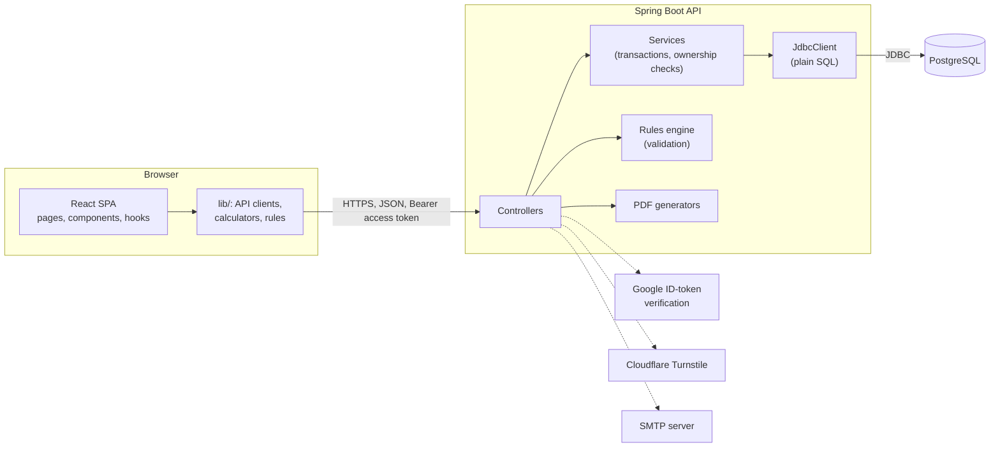

# Architecture

Formularium is a React single-page app, a Spring Boot REST API, and a PostgreSQL database. The database happens to be hosted by Supabase, but only as a Postgres host: the browser never talks to it.



## Who does what

| Concern | Where it lives |
|---|---|
| Accounts, sign-in, sessions, email confirmation, password reset | Backend (`auth/`) |
| Who may read or change which row | Backend services: every query carries the owner's id |
| Formula validation and compatibility rules | Backend (`rules/`), called through `POST /api/v1/validate` |
| PDF documents | Backend (`export/`, OpenPDF) |
| Calculators, auto-balancing, regional limits, batch planning | Frontend `lib/`: plain TypeScript, tested without a DOM |
| Storage | PostgreSQL, changed only through the SQL files in `supabase/migrations` |

## Request flow: signing in and staying signed in

1. `POST /api/v1/auth/login` returns a 15-minute access token in the body and sets a refresh token in an **HttpOnly** cookie scoped to `/api/v1/auth`.
2. The SPA keeps the access token only in memory and sends it as `Authorization: Bearer`.
3. When a request gets `401`, the client refreshes **once** (parallel requests share that refresh) and retries.
4. A refresh token works once: it is swapped for a new one, stored only as a SHA-256 hash. If an old token comes back after a short grace period, the whole sign-in family is revoked.
5. A page reload has no access token but still has the cookie, so the first protected call silently signs the person back in.

## Request flow: making a batch

1. The React modal collects size, lot number and which stash lots to draw from, and posts it through `lib/batches.ts`.
2. `BatchController` checks the token and hands the request to `BatchService`.
3. In **one transaction** the service checks the formula belongs to the caller, deducts each stash lot with a guard (`amount_left_g >= grams`, so two requests cannot overdraw it), works out the cost with estimates for ingredients without a price, and writes the batch, its lines, the stash usage and its check-in schedule.
4. If any step fails, nothing is kept and the person sees the backend's plain-language message.

## Backend packages

```
account/    data export
auth/       sign-up, sign-in, tokens, Google, Turnstile, email links, throttling
batches/    batches, stash deduction, costs, check-ins
community/  posts, comments, ratings, reports, mutes, moderation, notifications
formulas/   formulas, product types, version history
library/    ingredient library, stash, containers, favourites
rules/      validation rules and interaction checks
export/     PDF generators
starter/    the starter formulas every new account receives
config/     security and CORS
```

## Deployment

Live at [formularium.dev](https://formularium.dev). The frontend is static files on Vercel; the backend is one stateless jar in a Docker image on Render (`api.formularium.dev`); PostgreSQL stays on Supabase; Cloudflare holds the domain, DNS and email routing; confirmation and reset emails go out through Brevo's HTTPS API. The steps are in [deploy.md](deploy.md), and the backend's settings are in [`backend/.env.example`](../backend/.env.example). Several instances can run side by side: sessions and the sign-in throttling live in the database. The backend must only be reachable through the proxy that sets the client address, and `CLIENT_IP_HEADER` names the header it reads (see the checklist in [security.md](security.md)).
